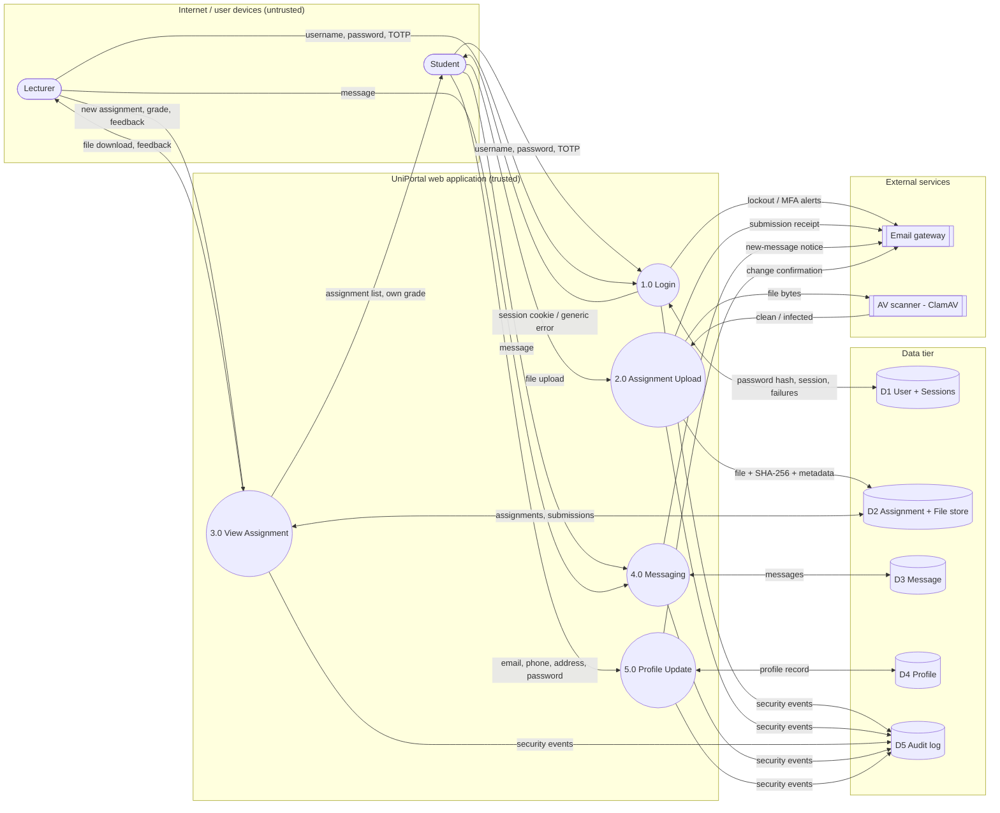

# UniPortal security design & traceability

This document links the app's code back to **Lab 1** (ATT&CK → ASVS 5.0) and **Lab 2**
(STRIDE). Every row names the file that implements the control and how to verify it.

> **About ASVS IDs:** controls are referenced at **section level** (e.g. *V6.3 General
> Authentication Security*). When you fill in your lab tables, look up the exact
> requirement numbers (e.g. 6.3.1) in the official ASVS 5.0 repository, because individual
> numbers were reorganised between 4.0.3 and 5.0. The lab handout's own IDs for story 1
> (6.3.1, 6.4.1, 6.2.1) are kept as given.

---

## 1. System architecture (Lab 2 Part 1)

| Element | In UniPortal |
|---|---|
| **Modules** | Login Module (`auth.py`), Assignment Upload + View Assignment (`assignments.py`), Messaging (`messages.py`), Update Profile (`profile.py`), plus Grades/Attendance (`views.py`) and Admin (`admin.py`) |
| **Database** | SQLite `instance/portal.db`: `users`, `profiles`, `assignments`, `submissions`, `messages` (+ `sessions`, `grades`, `attendance`, `courses`, `enrollments`, `audit_log`, `login_failures`, `mail_outbox`) |
| **File store** | `instance/uploads/`: random 32-hex names, no extension, outside the web root, mode 600 |
| **External services** | Email gateway (`mailer.py`: outbox table + optional SMTP/STARTTLS), Malware/AV (`filescan.py`: EICAR check + ClamAV) |
| **Cross-cutting** | `security.py` (CSRF, headers, RBAC, lockout, CAPTCHA, password policy, TOTP), `audit.py` (hash-chained audit log) |

## 2. DFD Level 1 with trust boundaries (Lab 2 Parts 2–3)

| Trust boundary | Description | Assets | Entry point |
|---|---|---|---|
| **TB01 External ↔ Login** | Untrusted browser/network meets authentication | Credentials, TOTP secrets, session tokens | `POST /login`, `POST /login/mfa`, `/captcha.svg` |
| **TB02 User ↔ Assignment Upload / View** | Untrusted file content enters the server and file store; lecturers download it | Submissions, grades, file store, lecturer workstation | `POST /assignments/<id>/submit`, `GET /assignments/submissions/<id>/download`, `POST …/grade` |
| **TB03 User ↔ Messaging** | User-generated text is stored and rendered in another user's browser | Message content, recipients' sessions | `POST /messages/new`, `GET /messages/<id>` |
| **TB04 User ↔ Profile Update** | Users modify their own personal data and credentials | PII (email, phone, address), password, MFA | `POST /profile/`, `/profile/password`, `/profile/mfa/disable` |
| **TB05 App ↔ Data stores** | Application talks to the DB and file store | All stored data, audit log | SQL queries, file reads/writes |
| **TB06 App ↔ External services** | Calls out to the email gateway and the AV engine | Notification content, uploaded files | SMTP, `clamdscan` / `clamscan` subprocess |

---

## 3. Lab 1 – user stories → ATT&CK → ASVS 5.0 → implementation

### Story 1 – Login to view grades
| ATT&CK technique | ASVS 5.0 | Implemented control | Code | Verify |
|---|---|---|---|---|
| **T1110 Brute Force** (.001 guessing, .003 spraying, .004 stuffing) | V6.3 (6.3.1), V2.4 anti-automation | CAPTCHA after 3 failures per account or 10 per IP; lockout after 5 failures / 15 min; per-IP block at 50; lockout alert email | `security.py` (`record_failure`, `lock_remaining`, `captcha_required`), `auth.login` | `check_controls.py` section "Brute-force"; Admin → Users shows *locked* |
| **T1110 / T1078 Valid Accounts** | V6.5 MFA, V6.2 (6.2.1) passwords | TOTP MFA (mandatory for lecturer/admin, optional for students), replay protection; ≥12-char passwords, common/context-word deny-list, no composition rules; scrypt hashes | `auth.mfa_setup`, `auth.login_mfa`, `security.verify_totp`, `security.password_problems` | Sign in as `lecturer1`; reuse a code → rejected |
| **T1589 Gather Victim Identity Info** (username harvesting) | V6.3 | Same message, status code and timing for unknown users vs bad passwords (dummy hash); lockout emulated for unknown usernames | `auth.login` (`_DUMMY_HASH`) | Compare `student1` + wrong pw with `nobody` |
| **T1539 Steal Web Session Cookie** | V7.2, V7.3, V7.4, V3.3 | Server-side sessions (only SHA-256 stored), new id at login, 15 min idle / 8 h absolute timeout, logout destroys server session, `__Host-` + Secure + HttpOnly + SameSite cookie | `auth.start_session`, `auth.load_logged_in_user`, `__init__.py` | Replay an old cookie after logout → redirected to login |
| **T1557 Adversary-in-the-Middle** | V12.1, V3.4 | HTTPS with TLS ≥ 1.2, HSTS | `run.py`, `security.security_headers` | `sslscan 127.0.0.1:8443` |

### Story 2 – Upload assignments
| ATT&CK technique | ASVS 5.0 | Implemented control | Code | Verify |
|---|---|---|---|---|
| **T1505.003 Web Shell** / **T1190 Exploit Public-Facing App** | V5.2, V5.3 | Extension allow-list (pdf/docx/txt) **and** content check (magic bytes, DOCX structure, UTF-8 text); random stored name, no extension, outside web root, never executed | `assignments.validate_upload`, `submit` | Upload `shell.php` and `shell.pdf` (PHP inside) → rejected |
| **T1204.002 User Execution: Malicious File** (lecturer opens it) | V5.2, V5.4 | EICAR + ClamAV scan before storing; PDFs with `/JavaScript`, `/Launch`, `/EmbeddedFile` and macro DOCX rejected; downloads forced as attachment with `CSP: sandbox` + nosniff | `filescan.py`, `assignments.download` | Upload the EICAR file → blocked |
| **T1499 Endpoint DoS** (huge files, zip bombs) | V5.2 | 5 MB file cap + request cap, DOCX zip-bomb check (≤ 1000 entries, ≤ 50 MB uncompressed) | `config.py`, `validate_upload` | Upload a > 5 MB file → 413 page |
| **T1565.001 Stored Data Manipulation** | V14.2, V16.3 | SHA-256 stored at upload and re-checked on every download; grade changes audited with old → new score | `assignments.download`, `assignments.grade` | Modify a file in `instance/uploads/` → download refused (409) |

### Story 3 – Lecturer messages students
| ATT&CK technique | ASVS 5.0 | Implemented control | Code | Verify |
|---|---|---|---|---|
| **T1189 Drive-by Compromise** (stored XSS) → **T1185 Browser Session Hijacking** | V1.2, V3.4 | Jinja2 auto-escaping, plain-text only, strict CSP (`default-src 'none'`, no scripts allowed at all), HttpOnly cookie | templates, `security.CSP` | Send `` → shown as text |
| **T1534 Internal Spearphishing** / **T1656 Impersonation** | V8.2, V2.3 | Sender taken from the session, "verified role" badge; recipients limited to shared courses; links not clickable; email notices don't include the body | `messages.contacts`, `message_view.html` | Try messaging the admin (id 1) → refused |
| **Unauthorised reading** (IDOR) | V8.2 | Only sender or recipient may open a message; denials logged | `messages.view` | `student2` → `/messages/1` → 403 |
| **Message flooding** | V2.4 | 5 messages/min per user, length limits (120 / 5000 chars) | `messages.compose` | Send 6 quickly → refused |

### Story 4 – Student updates profile
| ATT&CK technique | ASVS 5.0 | Implemented control | Code | Verify |
|---|---|---|---|---|
| **T1098 Account Manipulation** (change email to take over the account) | V6.4, V7.5 | Current password required to change email/password/MFA; confirmation email to the **old** address; password change signs out other sessions | `profile.update`, `profile.change_password` | Change email without password → refused |
| **Mass assignment → privilege escalation** | V15.3, V8.2 | Only `email`, `phone`, `address` are ever written, always for the session user; extra fields logged as `profile.unexpected_fields` | `profile.update` | Burp: add `role=admin` → still a student |
| **Injection via profile fields** (T1190) | V1.2, V2.2 | Allow-list validation (email/phone regex, single-line address ≤ 200), parameterised SQL | `profile.py`, `db.py` | sqlmap / manual `'` payloads |

---

## 4. Lab 2 Part 4 – STRIDE per trust boundary

### TB01: External ↔ Login
| STRIDE | TTP (MITRE) | Security requirement (lab) | How UniPortal implements it |
|---|---|---|---|
| Spoofing | T1110 Brute Force, T1078 Valid Accounts | MFA enabled | TOTP MFA (enforced for staff), lockout, CAPTCHA, scrypt hashes |
| Tampering | T1557 AiTM, T1190 (parameter tampering, SQLi) | Controlled UI | Server-side validation, CSRF tokens on every POST, parameterised SQL, session state held on the server |
| Repudiation | T1078 then denial; T1070 Indicator Removal | Confirmation emails | Lockout/MFA/password emails, append-only **hash-chained** audit log of every sign-in attempt |
| Info disclosure | T1557 AiTM, T1589 identity gathering | HTTPS | TLS 1.2+, HSTS, Secure/HttpOnly cookies, generic errors, no stack traces, no server banner |
| Denial of service | T1110 (lockout abuse), T1499 | CAPTCHA | CAPTCHA, per-IP throttling, *time-limited* (not permanent) lockout |
| Elevation of privilege | T1078 Valid Accounts (abusing a low-privilege account), forced browsing | Role-based UI | Menus per role **plus** server-side `roles_required` on every route and object-level checks |

### TB02: User ↔ Assignment Upload / View Assignment
| STRIDE | TTP (MITRE) | Security requirement | Implementation |
|---|---|---|---|
| Spoofing | T1078 (submit as another student) | Owner taken from session | `student_id` always comes from the session, never from the form |
| Tampering | T1565.001 Stored Data Manipulation | Integrity hashes | SHA-256 recorded + verified on download; no resubmission after grading/deadline |
| Repudiation | "I did submit it" / "I never uploaded that" | Submission receipts | Emailed receipt with SHA-256 + timestamp, `submission.uploaded` audit entry |
| Info disclosure | IDOR / path traversal (T1083) | Object-level authorisation | Random names, no user-supplied paths, owner/course-lecturer checks |
| Denial of service | T1499 large files, zip bombs | Size limits | 5 MB cap, zip-bomb check |
| Elevation of privilege | T1505.003 Web Shell, T1204.002 Malicious File | File validation + AV | Type allow-list + magic bytes, active-content rejection, ClamAV, download sandbox |

### TB03: User ↔ Messaging
| STRIDE | TTP (MITRE) | Security requirement | Implementation |
|---|---|---|---|
| Spoofing | T1534 Internal Spearphishing, T1656 Impersonation | Verified sender identity | Sender from session + role badge; contacts limited to shared courses |
| Tampering | Message alteration | Immutable records | No edit/delete feature; CSRF on send |
| Repudiation | Denying a message was sent | Logging | `message.sent` audit entry with sender and recipient |
| Info disclosure | IDOR on `/messages/<id>` | Authorisation | Only sender/recipient may read; email notice has no body |
| Denial of service | Message flooding | Rate limit | 5/min per user, length limits |
| Elevation of privilege | T1189 stored XSS → T1185 session hijack | Output encoding | Auto-escaping, strict CSP, HttpOnly cookies |

### TB04: User ↔ Profile Update
| STRIDE | TTP (MITRE) | Security requirement | Implementation |
|---|---|---|---|
| Spoofing | T1539 stolen session | Re-authentication | Password needed for email/password/MFA changes; idle timeout |
| Tampering | T1098 Account Manipulation | Field allow-list | Only 3 editable columns; validation |
| Repudiation | Denying a change | Notification + logging | Email to old address, `profile.updated` lists the changed fields |
| Info disclosure | IDOR on other profiles | Session-bound access | No user-id parameter exists; always the signed-in user |
| Denial of service | Oversized input | Length limits | Max lengths enforced server-side |
| Elevation of privilege | Mass assignment `role=admin` | Allow-list | Ignored and logged as `profile.unexpected_fields` |

### TB05: App ↔ Data stores and TB06: App ↔ External services
| STRIDE | Threat | Implementation |
|---|---|---|
| Tampering / Info disclosure | SQL injection (T1190) | 100 % parameterised queries (`db.py`) |
| Info disclosure | DB theft → offline cracking | scrypt password hashes; session ids stored only as SHA-256 |
| Repudiation | Admin/attacker edits logs (T1070) | Audit log: DB triggers block UPDATE/DELETE, SHA-256 hash chain detects edits (`manage.py verify-audit`, Admin → Audit log) |
| Elevation of privilege | Command injection via AV call | `subprocess.run([...])` with no shell; the path is server-generated |
| Info disclosure | Email interception | SMTP over STARTTLS; email notices never contain message bodies or passwords |
| Denial of service | AV engine down | Configurable: `PORTAL_AV_REQUIRED=1` fails closed (rejects uploads) |

---

## 5. Known gaps (the "Notes / Gaps" column)

* **CAPTCHA is self-hosted and demo-grade.** It stops Hydra and simple scripts, but the SVG
  text is machine-readable. Production should use hCaptcha / reCAPTCHA / Cloudflare Turnstile.
* **MFA is optional for students** (matches the lab's gap "MFA not yet enforced for all
  users"). Enforce it with `PORTAL_MFA_ENFORCED_ROLES=student,lecturer,admin`.
* **No encryption at rest**: the SQLite DB and the TOTP secrets are not encrypted. Production
  would use an encrypted volume and a KMS-wrapped key for MFA secrets.
* **Account lockout can be abused** to lock a victim out for 15 minutes (DoS trade-off).
* **IP throttling is coarse.** Everyone behind one NAT shares a counter. `X-Forwarded-For` is
  deliberately not trusted.
* **PDF active-content check is a heuristic.** Compressed object streams can hide `/JS`, so
  the AV scan and the download sandbox remain the main defence.
* **No self-service password reset.** Admins use `manage.py set-password`. A real reset flow
  would need ASVS V6.4 (time-limited single-use tokens).
* **Development web server.** Production should run behind gunicorn + nginx with a CA-issued
  certificate.
* **Small common-password list.** Replace `portal/common_passwords.txt` with a larger list
  (e.g. SecLists) or a breached-password API (k-anonymity).
